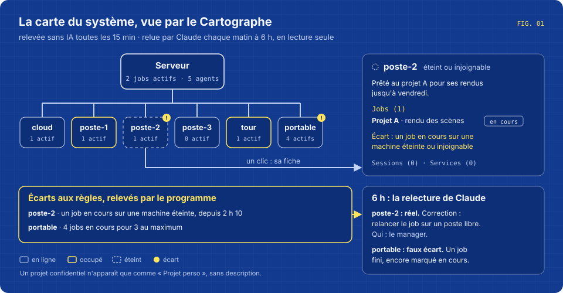
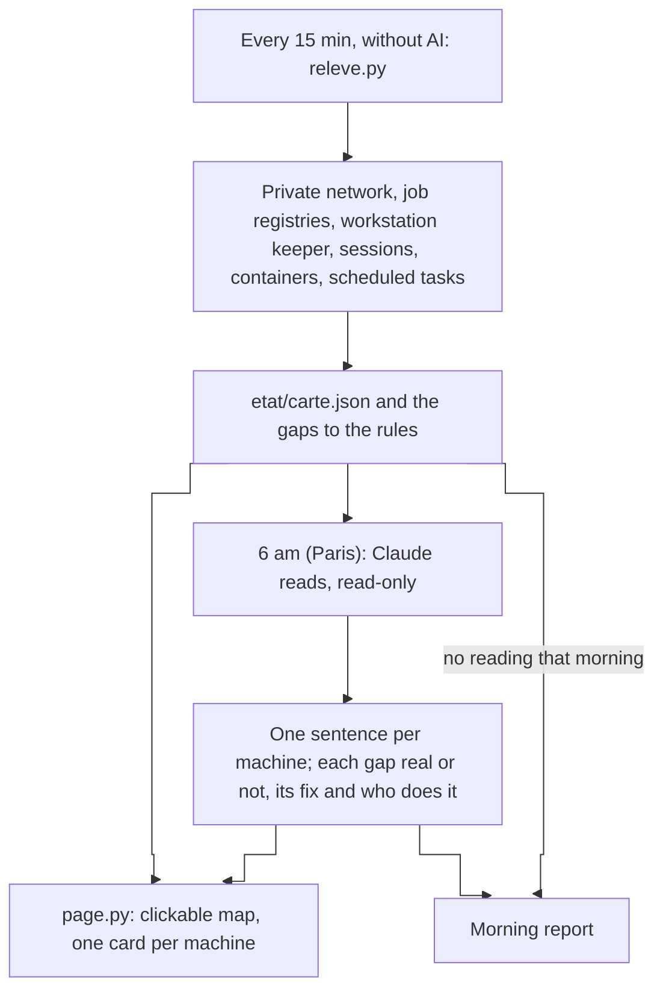
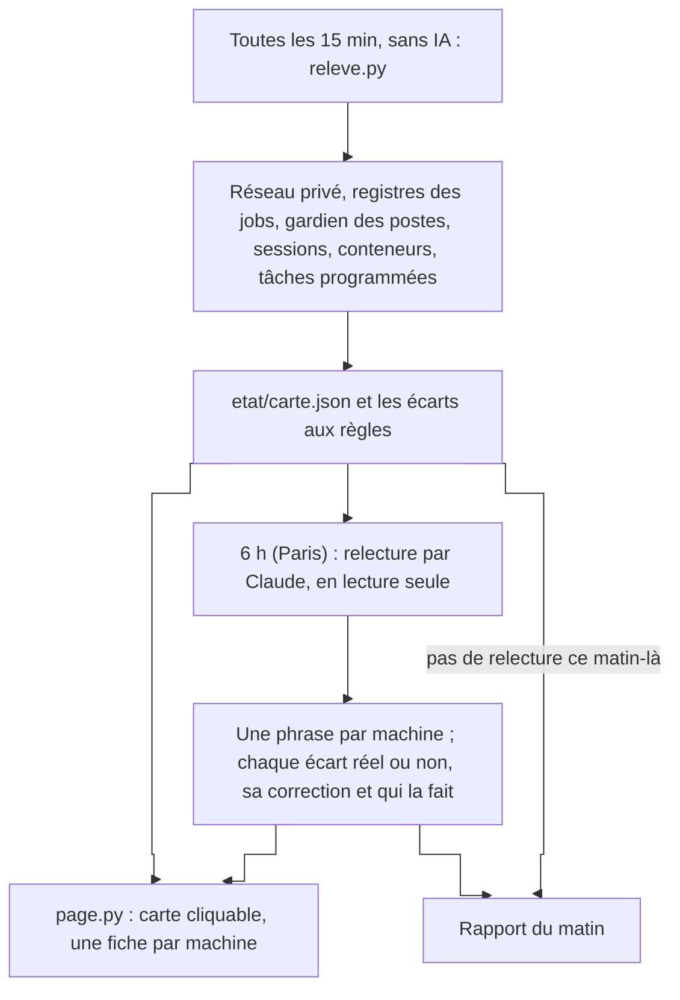

# Agent - Cartographer

Every 15 minutes, it redraws the map of a system of AI agents: the machines, what runs on each one, and the gaps with the rules; every morning, Claude reads the map and explains the gaps.





**English** · [Français](#version-française)

## What it does

- **Surveys the whole system every 15 minutes, without AI.** `releve.py` reads the machines of the private network (Tailscale), the central job registry and the registries of the sub-managers, the keeper of the loaned workstations, the cards of the permanent agents, the sessions and Claude processes on the server, its containers, its scheduled tasks, its load and its memory. It only reads.
- **Checks the placement rules in code.** No work agent on the server before a set date; the server never saturated (load above 8, swap above 80 %); the tower only for one allowed use; at most N active jobs on the laptop; no job "running" on a machine that is off; no loaned workstation busy without a declared job. Each gap is written down with its time.
- **Draws the map.** `page.py` writes one HTML page: a diagram of the server and the machines around it with right-angled links, one card per machine (jobs and their progress, permanent agents, sessions, online services, public ports marked), the list of gaps. The page reloads itself every 5 minutes.
- **Has Claude read it every morning at 6 am, Paris time.** Claude gets the map, the gaps since 6 am the day before (with start and end time), the rules in plain words and its own reading of the day before. It writes one sentence per machine on what it is used for now, says for each gap whether it is real or a false gap (a registry badly kept, a job finished but still marked running), gives the fix and who should make it, and notes what the program cannot see.
- **Puts the result in the morning report.** If Claude's reading did not happen, the report gives the program's gaps alone, with their hours.
- **Hides a confidential project.** Any job, session or service that matches the words in `etat/secret.local` shows only as "Projet perso", with no description.

It is meant for someone who runs many agents on several machines and wants to know what runs where without opening each machine.

## The morning report

```
Carte : https://tableau.example.org/carte/

Deux postes prêtés sont occupés, le serveur est calme. Un écart demande une action : un job marqué en cours sur un poste éteint.

Écarts aux règles (relus par Claude) :
• poste-2 — Un job en cours sur une machine éteinte ou injoignable : réel. Le poste s'est éteint à 2 h et le job n'a pas été repris. Correction : relancer le job sur un poste libre (MANAGER).
• laptop — Laptop : 3 agents au maximum : faux écart. Un des quatre jobs est fini mais encore marqué « en cours » dans son registre.

Vu en plus :
• Le même job figure dans deux registres sous deux noms.
```
*(fictional example; the report is written in French)*

## What it never does

- Change anything on a machine. The survey runs read-only commands: network status, registries, process list, `docker ps`, `crontab -l`.
- Run a command or go on the web during the morning reading. Claude gets `Read`, and writing to one file, `sortie/claude.json`; `Bash`, `WebFetch` and `WebSearch` are refused. This is set by the permission flags `nuit.sh` passes to Claude Code, not only by the instructions.
- Fix a gap itself: it says what to do and who should do it.
- Show the name or the description of the confidential project.

## Requirements

Taken from `releve.sh`, `releve.py`, `page.py`, `nuit.sh` and `deposer.py`:

- A Linux server, the one at the centre of the system, with `bash`, `cron`, `flock`, `perl`, `python3` (3.9 or later), `tmux`, `ps` and `crontab`.
- The `tailscale` command, for the list of machines and whether they are online.
- SSH to an account that can run `docker ps` (target in `VPS_ROOT` or `~/.config/agents/vps-root`).
- What it reads when it exists, and treats as empty otherwise: the central job registry, the registries of the sub-managers, the cards of the permanent agents, and the workstation keeper (`parc.py etat --json`).
- A folder served by a web server, where `page.py` writes `carte/index.html` (`/home/claude/agents-permanents-dash/`, which must exist), and its address in `TABLEAU_URL` or `~/.config/agents/tableau-url`.
- For the morning reading: a launcher that starts a Claude Code agent on a loaned workstation and returns code 75 when none is free, an account selector and the token files it reads, [Claude Code](https://code.claude.com/docs/en/overview) on the workstation. The reading waits in the same queue as other agents (`/tmp/agents-site.lock`).
- Outside this repository: the tool that builds the morning report.

The diagram has fixed places: the server, the Claude cloud sessions, six loaned workstations, the tower, the laptop and a second server. Their keys are written in `page.py` and `releve.py`; a machine with another key gets a card but no box in the diagram. The paths under `/home/claude` are written in the scripts; on another installation, change them.

## Install

```bash
git clone https://github.com/anthohunt/agent-cartographe
cd agent-cartographe
mkdir -p etat ~/.config/agents
cat > etat/machines.local.json <<'EOF'
{"noms_postes": {"PC-0001": "poste-1", "PC-0002": "poste-2"},
 "roles": {"mon-serveur": ["vps", "Serveur"], "ma-tour": ["tour", "Tour"], "mon-portable": ["laptop", "Portable"]},
 "legende_postes": "Postes prêtés",
 "regles": {"vps_sans_agent_jusqua": "2026-12-01T00:00", "vps_sans_agent_texte": "Aucun agent de travail sur le serveur",
            "tour_motif_permis": "rendu|essai", "tour_texte": "La tour sert aux rendus et aux essais", "laptop_max": 3}}
EOF
cp regles.exemple.md etat/regles.local.md       # the same rules in plain words, for Claude
echo "utilisateur@serveur" > ~/.config/agents/vps-root
echo "https://tableau.example.org" > ~/.config/agents/tableau-url
./releve.sh                                      # first survey and first map
python3 deposer.py "$(TZ=Europe/Paris date +%F)" --apercu
# crontab: nuit.sh checks Paris time itself and only works between 6 and 8 am
# */15 * * * * /chemin/releve.sh
# 0,30 * * * * /chemin/nuit.sh
```

The keys of `roles` are the machine names on the private network; `noms_postes` gives a short name to each loaned workstation. Without `etat/machines.local.json`, the scripts use `machines.exemple.json`; without `etat/regles.local.md`, Claude reads `regles.exemple.md`. `deposer.py <date> --apercu` prints the part of the morning report without sending it. If no workstation is free at 6 am, `nuit.sh` tries again at the next half hour; once the report is filed, a marker in `logs/` stops it for the day. `FORCE=1` runs it outside the window.

`releve.sh` creates `logs/` and `etat/`, `nuit.sh` creates `verrous/`. They stay out of git, like the local files.

## Files

| File | Role |
|---|---|
| `releve.sh` | Every 15 minutes: survey, then page; keeps 14 days of gaps and a short log. |
| `releve.py` | The survey without AI: machines, jobs, agents, sessions, services, gaps to the rules. Writes `etat/carte.json`. |
| `page.py` | The map page: diagram, one card per machine, gaps, Claude's reading if there is one. |
| `nuit.sh` | The morning reading: a fresh survey, Claude on a loaned workstation (40 minutes at most, read-only), then the page and the report. |
| `consigne.md` | The instructions given to Claude for the reading. |
| `ecarts-jour.py` | Groups the gaps since 6 am the day before: start, end, number of surveys. |
| `deposer.py` | Writes the cartographer's part of the morning report. |
| `machines.exemple.json`, `regles.exemple.md` | Generic examples of the machine list and of the rules. |
| `etat/machines.local.json`, `etat/regles.local.md`, `etat/secret.local` | The machines, the rules and the words of the confidential project of the installation, outside the repository. |

The instructions and comments are in French. It is one of the permanent agents that run on their own every day in a small system of Claude Code agents.

## Its page

[Its page on ingevision.cloud](https://ingevision.cloud/en/ai-agents/?p=agent-cartographe) presents what it does, in English and French.

---

## Version française

# Agent - Cartographe

Toutes les 15 minutes, il redessine la carte d'un système d'agents IA : les machines, ce qui tourne sur chacune et les écarts aux règles ; chaque matin, Claude relit la carte et explique les écarts.




### Ce qu'il fait

- **Relève tout le système toutes les 15 minutes, sans IA.** `releve.py` lit les machines du réseau privé (Tailscale), le registre central des jobs et ceux des sous-managers, le gardien des postes prêtés, les fiches des agents permanents, les sessions et processus Claude du serveur, ses conteneurs, ses tâches programmées, sa charge et sa mémoire. Il ne fait que lire.
- **Vérifie les règles de placement dans le code.** Aucun agent de travail sur le serveur avant une date fixée ; le serveur jamais saturé (charge au-dessus de 8, mémoire d'échange au-dessus de 80 %) ; la tour pour un seul usage permis ; au plus N jobs actifs sur le portable ; aucun job « en cours » sur une machine éteinte ; aucun poste prêté occupé sans job déclaré. Chaque écart est noté avec son heure.
- **Dessine la carte.** `page.py` écrit une page HTML : un schéma du serveur et des machines autour, reliées à angles droits, une fiche par machine (jobs et avancement, agents permanents, sessions, services en ligne, ports publics signalés), la liste des écarts. La page se recharge seule toutes les 5 minutes.
- **Fait relire la carte par Claude chaque matin à 6 h, heure de Paris.** Claude reçoit la carte, les écarts depuis la veille 6 h (avec heure de début et de fin), les règles en langage courant et sa relecture de la veille. Il écrit une phrase par machine sur ce à quoi elle sert en ce moment, dit pour chaque écart s'il est réel ou si c'est un faux écart (un registre mal tenu, un job fini mais encore marqué en cours), donne la correction et qui doit la faire, et note ce que le programme ne voit pas.
- **Met le résultat dans le rapport du matin.** Si la relecture de Claude n'a pas eu lieu, le rapport donne les écarts du programme seul, avec leurs heures.
- **Masque un projet confidentiel.** Tout job, session ou service qui correspond aux mots de `etat/secret.local` apparaît seulement comme « Projet perso », sans description.

Il sert à une personne qui fait tourner beaucoup d'agents sur plusieurs machines et veut savoir ce qui tourne où sans ouvrir chaque machine.

### Le rapport du matin

```
Carte : https://tableau.example.org/carte/

Deux postes prêtés sont occupés, le serveur est calme. Un écart demande une action : un job marqué en cours sur un poste éteint.

Écarts aux règles (relus par Claude) :
• poste-2 — Un job en cours sur une machine éteinte ou injoignable : réel. Le poste s'est éteint à 2 h et le job n'a pas été repris. Correction : relancer le job sur un poste libre (MANAGER).
• laptop — Laptop : 3 agents au maximum : faux écart. Un des quatre jobs est fini mais encore marqué « en cours » dans son registre.

Vu en plus :
• Le même job figure dans deux registres sous deux noms.
```
*(exemple fictif)*

### Ce qu'il ne fait jamais

- Changer quoi que ce soit sur une machine. Le relevé ne lance que des commandes de lecture : état du réseau, registres, liste des processus, `docker ps`, `crontab -l`.
- Lancer une commande ou aller sur le web pendant la relecture du matin. Claude a `Read`, et l'écriture d'un seul fichier, `sortie/claude.json` ; `Bash`, `WebFetch` et `WebSearch` sont refusés. C'est réglé par les options de permission que `nuit.sh` passe à Claude Code, pas seulement par la consigne.
- Corriger un écart lui-même : il dit quoi faire et qui doit le faire.
- Montrer le nom ou la description du projet confidentiel.

### Ce qu'il faut

Tiré de `releve.sh`, `releve.py`, `page.py`, `nuit.sh` et `deposer.py` :

- Un serveur Linux, celui qui est au centre du système, avec `bash`, `cron`, `flock`, `perl`, `python3` (3.9 ou plus), `tmux`, `ps` et `crontab`.
- La commande `tailscale`, pour la liste des machines et leur présence en ligne.
- Un accès SSH à un compte qui peut lancer `docker ps` (cible dans `VPS_ROOT` ou `~/.config/agents/vps-root`).
- Ce qu'il lit s'il existe, et compte pour vide sinon : le registre central des jobs, les registres des sous-managers, les fiches des agents permanents et le gardien des postes (`parc.py etat --json`).
- Un dossier servi par un serveur web, où `page.py` écrit `carte/index.html` (`/home/claude/agents-permanents-dash/`, qui doit exister), et son adresse dans `TABLEAU_URL` ou `~/.config/agents/tableau-url`.
- Pour la relecture du matin : un lanceur qui démarre un agent Claude Code sur un poste prêté et rend le code 75 quand aucun n'est libre, un sélecteur de compte et les fichiers de jetons qu'il lit, [Claude Code](https://code.claude.com/docs/en/overview) sur le poste. La relecture attend dans la même file que d'autres agents (`/tmp/agents-site.lock`).
- Hors de ce dépôt : l'outil qui assemble le rapport du matin.

Le schéma a des places fixes : le serveur, les sessions Claude dans le cloud, six postes prêtés, la tour, le portable et un second serveur. Leurs clés sont écrites dans `page.py` et `releve.py` ; une machine qui a une autre clé a une fiche mais pas de case dans le schéma. Les chemins sous `/home/claude` sont écrits dans les scripts ; sur une autre installation, il faut les changer.

### Installation

```bash
git clone https://github.com/anthohunt/agent-cartographe
cd agent-cartographe
mkdir -p etat ~/.config/agents
cat > etat/machines.local.json <<'EOF'
{"noms_postes": {"PC-0001": "poste-1", "PC-0002": "poste-2"},
 "roles": {"mon-serveur": ["vps", "Serveur"], "ma-tour": ["tour", "Tour"], "mon-portable": ["laptop", "Portable"]},
 "legende_postes": "Postes prêtés",
 "regles": {"vps_sans_agent_jusqua": "2026-12-01T00:00", "vps_sans_agent_texte": "Aucun agent de travail sur le serveur",
            "tour_motif_permis": "rendu|essai", "tour_texte": "La tour sert aux rendus et aux essais", "laptop_max": 3}}
EOF
cp regles.exemple.md etat/regles.local.md       # les mêmes règles en langage courant, pour Claude
echo "utilisateur@serveur" > ~/.config/agents/vps-root
echo "https://tableau.example.org" > ~/.config/agents/tableau-url
./releve.sh                                      # premier relevé et première carte
python3 deposer.py "$(TZ=Europe/Paris date +%F)" --apercu
# crontab : nuit.sh vérifie lui-même l'heure de Paris et ne travaille qu'entre 6 h et 8 h
# */15 * * * * /chemin/releve.sh
# 0,30 * * * * /chemin/nuit.sh
```

Les clés de `roles` sont les noms des machines sur le réseau privé ; `noms_postes` donne un nom court à chaque poste prêté. Sans `etat/machines.local.json`, les scripts prennent `machines.exemple.json` ; sans `etat/regles.local.md`, Claude lit `regles.exemple.md`. `deposer.py <date> --apercu` affiche la partie du rapport du matin sans l'envoyer. Si aucun poste n'est libre à 6 h, `nuit.sh` réessaie à la demi-heure suivante ; une fois le rapport déposé, une marque dans `logs/` l'arrête pour la journée. `FORCE=1` le lance hors du créneau.

`releve.sh` crée `logs/` et `etat/`, `nuit.sh` crée `verrous/`. Ils restent hors de git, comme les fichiers locaux.

### Fichiers

| Fichier | Rôle |
|---|---|
| `releve.sh` | Toutes les 15 minutes : relevé, puis page ; garde 14 jours d'écarts et un journal court. |
| `releve.py` | Le relevé sans IA : machines, jobs, agents, sessions, services, écarts aux règles. Écrit `etat/carte.json`. |
| `page.py` | La page de la carte : schéma, une fiche par machine, écarts, relecture de Claude s'il y en a une. |
| `nuit.sh` | La relecture du matin : un relevé neuf, Claude sur un poste prêté (40 minutes au plus, en lecture seule), puis la page et le rapport. |
| `consigne.md` | La consigne donnée à Claude pour la relecture. |
| `ecarts-jour.py` | Regroupe les écarts depuis la veille 6 h : début, fin, nombre de relevés. |
| `deposer.py` | Écrit la partie cartographe du rapport du matin. |
| `machines.exemple.json`, `regles.exemple.md` | Des exemples génériques de la liste des machines et des règles. |
| `etat/machines.local.json`, `etat/regles.local.md`, `etat/secret.local` | Les machines, les règles et les mots du projet confidentiel de l'installation, hors dépôt. |

Fait partie des agents permanents qui tournent seuls chaque jour dans un petit système d'agents Claude Code.

### Sa fiche

[Sa fiche sur ingevision.cloud](https://ingevision.cloud/agents-ia/?p=agent-cartographe) présente ce qu'il fait, en français et en anglais.

---

**Anthony Hunt** · [AI agents on ingevision.cloud](https://ingevision.cloud/en/ai-agents/) · [LinkedIn](https://www.linkedin.com/in/anthony-hunt-3948a9196) · [GitHub profile](https://github.com/anthohunt) · anthony@ingevision.cloud
